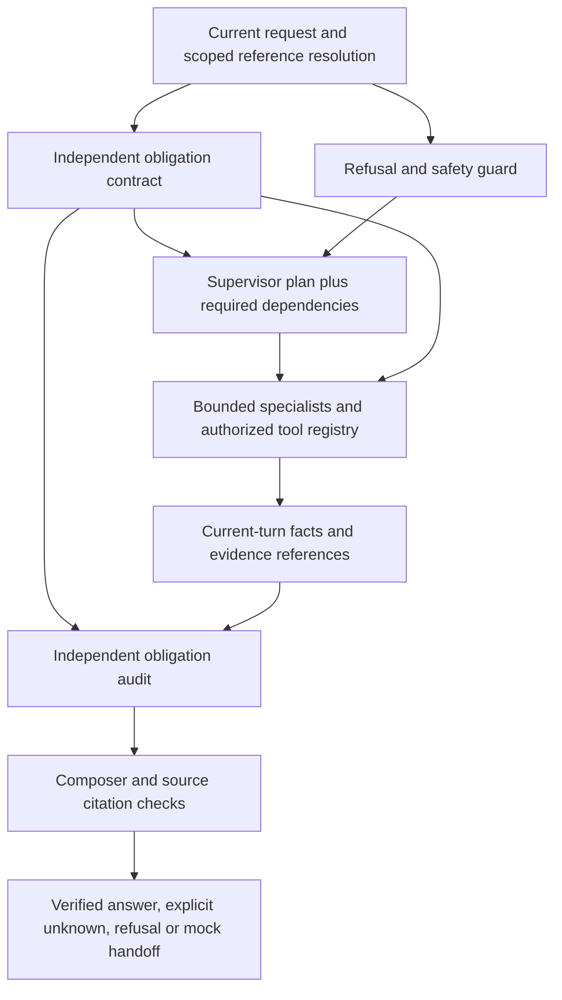

# Request obligation contract — Phase 9 repair

Status: implemented with offline regressions; targeted live verification in progress. This extends the approved v3 information/mock-handoff product. No transaction execution, new external service or knowledge graph is added.

The initial frozen run exposed a circular check: the composer was validated against the supervisor's own intent list. A tracking-only plan could therefore omit a refund request and still pass intent coverage. The new contract is derived separately from the current customer request and code-resolved session references, before planning. It remains immutable for the turn.

## Requirements and evidence

Recognized obligations cover order tracking/status, return/refund/cancellation eligibility, product information, warranty and policy sources. The contract records canonical intent labels, the selected order reference, public catalog SKU where uniquely resolved, required request types and authoritative document families. It never supplies policy values or order facts. Public catalog matching selects a tool argument; answers still require the typed product read. Multiple explicit orders require clarification rather than silently choosing one.

Plan normalization inserts missing specialists and order-before-policy dependencies. Specialists retain their existing tool allowlists. Required reads are performed before model-controlled tool work, and missing reads are backfilled through the same typed registry, ownership check, current-turn category validation, timeouts and eight-call budget; the handoff slot remains reserved. No obligation permits a new write. Failed reads remain visible. Refund-threshold review is latched as soon as the owned order supplies the verified amount; eligibility results also retain threshold and cancellation triggers. This protects T2 if later model tool attempts exhaust the budget. Source conflicts come from retrieval.

Evidence checks match the required order and request type, not merely the presence of a similarly named tool. The final response must retain recognized obligations independently of planner labels. An answered outcome requires complete required evidence. Citation checks require the authoritative policy family and, when retrieved, the exact section/version referenced by the eligibility calculation. An FAQ cannot substitute for the return-window rule. A current order/shipping fact does not by itself require a shipping-policy citation.

The response record includes the contract, evidence audit and an explicit safe-fallback flag. Customer text is not added to operational traces. The contract is turn-local and is not added to projection memory; privacy-minimized evaluation exports contain the diagnostic record. Metadata-only LangSmith tracing remains in use.

## Safety and conversation repairs

SSN-first storage wording, double refunds, out-of-window overrides, record tampering and explicit nonownership are recognized by the versioned input guard. The supervisor's safety bit cannot independently assert an injury. Real recognized injury/human/legal flags remain append-only and survive planning, clarification and model failure.

Public phrases such as “the speaker” can resolve through the public catalog without requiring an owned order. “Send them back” can use a verified, scoped earlier order; reset, expiry and ownership failures continue to clear that reference. Requests contradicting an earlier shipping statement fetch current records. Feedback-only “too verbose” is stored as a controlled style signal when consent and a successful previous answer permit it; it does not need an LLM reply.

## Limits and release evidence

The obligation parser is an inspectable, bounded lexical grammar, not unrestricted language understanding. Unrecognized paraphrases can still depend on planning or clarification. Citation presence and exact source matching are structural safeguards, not general semantic entailment. Safe fallbacks and unknowns must remain distinct from completed answers. Before acceptance, rerun the frozen cases, repeat the safety subset, review semantic failures and calibration, then lock the build and use the untouched holdout without tuning.

The original 65-case baseline and original evaluator labels remain preserved. Any context-label correction is a separate version with a rationale; changed software does not rewrite earlier results.

## Revision 3.3 follow-through (2026-10-17)

The v2 obligation contract records missing-reference requirements and specifically requested policy sections. Successful retrieval cannot turn an unresolved individual eligibility question into ANSWERED. Public conditional product-policy questions remain usable without an order. Category exclusion cites the exclusion rule alone because a return-window calculation was not used. Restocking questions require the actual restocking section. Multi-order clarification retains every recognized intent and asks the customer to choose one order/request. A failed required preflight read moves toward honest failure disclosure rather than model retries consuming the handoff budget. Mixed feedback/tracking follow-ups refresh the prior tracking intent and pass only a controlled, actually saved feedback signal to composition.

Combined planner/composer failures retain recognized request labels and explicitly disclose unverified information. Withdrawing a cancellation does not create a new cancellation-eligibility request or ticket; a bounded clarification explains that this assistant has executed no cancellation. Other simultaneous intents and safety flags retain priority.

## Public policy and evidence retention repair — 60bc5d5

A resolved public policy question does not inherit a private-order clarification merely because its wording contains “send it back.” Guard-in and plan normalization now reconcile memory hints with the independently derived current scope. Private eligibility without an authorized reference still requires clarification. Explicit FAQ comparisons require that requested FAQ in addition to the governing return policy; FAQ authority never substitutes for a policy rule. Verified retrieval, rather than the customer's assertion of a disagreement, establishes T3.

Recent carrier scans require current tracking evidence. Future delivery/arrival certainty requests additionally require the shipping policy even when an order is explicit; a past delivery mentioned in a return question alone does not add that requirement. Generated search arguments retain only bounded public topic hints, never the full arbitrary customer message. These rules remain a bounded lexical grammar with paraphrase limitations.

If composition fails, the safe fallback can retain policy sources actually retrieved this turn, including exact eligibility-rule and conflict references. A calculator's policy pointer alone is insufficient: the reference must intersect canonical current evidence and real search results. The fallback still discloses missing verification and never promotes an unanswered request to ANSWERED. Offline coverage includes empty retrieval, forced composition failure and both conflict sources. Fresh frozen, repeat, human and independent holdout results remain separate gates.

The follow-up 5e647e3 narrows delivery timing to future predicates rather than a distant “today” token. Explicit international/Canada shipping questions require the dispatch section containing the actual unsupported-service rule. Public topic hints are limited to FAQ comparison queries so unrelated retrieval is unaffected. The partial failed development run remains preserved; 261 offline tests pass.
